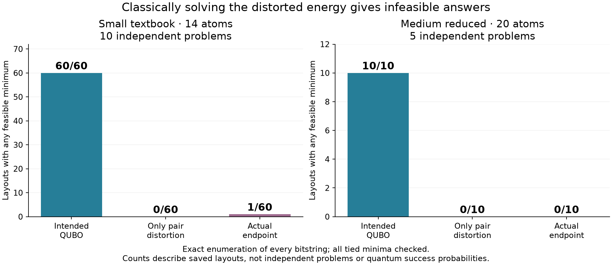

# Classical solving confirms embedding distortion changes the answers

## 1. What this is

**Yes. In the small textbook and medium cases we tested, replacing only the intended pair interactions with the physical interactions changes a feasible intended minimum into an infeasible minimum.** This is a controlled comparison of classical energy functions. It goes beyond observing a large matrix error, while stopping short of predicting quantum sampling probabilities.

The comparison prioritizes all ten small textbook problems, all five medium reduced problems, and all five medium textbook problems in the saved primary study. Adjusted-penalty models are kept separate because their intended targets may already be wrong.

## 2. What was done

For each saved geometry we classically solved three binary quadratic energies:

\[
E_{\mathrm{intended}}(x)=\alpha\sum_i h_i x_i+\alpha\sum_{i<j}J_{ij}x_ix_j,
\]
\[
E_{\mathrm{pairs}}(x)=\alpha\sum_i h_i x_i+\sum_{i<j}U_{ij}x_ix_j,
\]
\[
E_{\mathrm{endpoint}}(x)=\sum_i\widetilde h_i x_i+\sum_{i<j}U_{ij}x_ix_j.
\]

The second changes **only pair interactions**, retaining the correct intended individual fields. The third also uses actual endpoint detunings, including individual-control modulation where present. Physical interactions come from the saved coordinates and device, with Pulser's six-decimal distance rounding. The applied conversion scale is unchanged. Constants are dropped consistently because they do not change minimizers. Symmetric matrices store full unordered-pair coefficients, counted once.

Every returned answer is decoded and evaluated against the original customer-assignment rules, capacity limit, and clustering objective. Vehicle relabelings are not counted as errors. Raw energy values from different functions are not used as a common quality score.

All small cases and all selected 20-atom medium cases were solved by enumerating every bitstring, checking **every tied minimum**. This covered 178 saved conditions, 486 distinct coefficient systems, and **35,982,144 state evaluations**, taking 37.26 measured seconds. Independent verification checked all 534 condition/variant comparisons.

For larger QUBOs, an exact product-variable reformulation was sent to the classical HiGHS solver through [SciPy's integer-optimization interface](https://docs.scipy.org/doc/scipy/reference/generated/scipy.optimize.milp.html). Each unique solve has a ten-second limit. Products are linked to binary variables by all three linear inequalities; no clustering constraints are silently imposed on these unrestricted QUBO solves. Returned bits, product constraints, and energies are independently validated. Timeouts remain unproven incumbents, not claimed optima.

Separately, exact original clustering references and sufficient penalty bounds certify the intended primary textbook minima. Fifteen additional five-second-budget solves restricted **only decoded assignment and capacity feasibility**, leaving helper bits free, establish whether any feasible physical minimum could exist.

## 3. Results

### The main failure region

Counts below are saved layouts having at least one feasible lowest-energy answer, not quantum probabilities or independent problem counts.

| Primary formulation | Independent problems | Layouts | Intended QUBO | Only pair distortion | Actual endpoint |
|---|---:|---:|---:|---:|---:|
| Small textbook, 14 atoms | 10 | 60 | 60/60 | **0/60** | **1/60** |
| Medium reduced, 20 atoms | 5 | 10 | 10/10 | **0/10** | **0/10** |
| Medium textbook, 45 atoms | 5 | 10 | 10/10 | **0/10** | **0/5 available** |

The small textbook study uses two embedding methods and three placement seeds per problem. Medium uses both methods and the first preselected placement seed per problem. Five medium textbook BLaDE geometries failed preparation: their hypothetical pair-distorted energies can be evaluated, but no actual pulse endpoint exists for them. They are not represented as executed experiments.

**Small textbook:** every intended minimum is feasible and original-optimal on all ten problems. Pair distortion alone eliminates all feasible minima across all 60 layouts. Adding actual control mismatch changes this outcome in one layout, whose minimum is feasible and optimal; it does not restore feasibility in the other 59.

**Medium reduced:** every intended minimum is feasible, but the balance formulation preserves the original optimum on only four of five problems. That separate formulation error is retained in the comparison. In all ten layouts, both the pair-distorted and actual-endpoint energies have a **unique infeasible minimum**. The five BLaDE layouts assign customers once but overload capacity; the five custom layouts violate assignment validity.

For one concrete medium problem, each vehicle can carry 20 load units. An intended optimal assignment has vehicle loads **17, 14, 20**. After changing only BLaDE's pair interactions, the unique minimum has loads **0, 29, 22**. This is a change in the preferred answer, not merely a numerical mismatch in coefficients.

Across the medium reduced cases, the best feasible answer lies **9.799–67.928** physical energy units above the pair-distorted minimum, or **5.166–58.288** above the actual-endpoint minimum. These separations are much larger than the tie tolerance. Energy magnitudes are instance-scaled and should not be pooled as a cross-instance performance score.

**Medium textbook:** intended minima are certified feasible and optimal using the exact reference and conservative penalties, even though the generic QUBO solver times out on their proof. All ten pair-distorted unrestricted solves return certified infeasible minima. Crucially, independent feasible-set bounds prove that **no feasible answer can tie a minimum in any of the ten cases**. The same is proved for all five available actual endpoints. The smallest bound separation is approximately **6.336**, compared with a maximum numerical comparison tolerance of approximately **0.000729**. One restricted solve timed out, but its lower bound still sufficed for the proof.

### Why this is stronger than the earlier error table

The intended and pair-distorted variants use the same problem, penalties, conversion scale, and individual fields. Only the pair interactions change. On these tested cases, pair distortion is therefore sufficient to destroy feasibility of the classical ground-state solution. This conclusion does not rely on the cloud simulator, its convergence, quantum shot noise, or a heuristic sampler failing to find the right state.

This does **not** mean a relative error near one always destroys solutions. The small reduced controls include instances where distortion preserves or improves the decoded answer. The direct solve is the relevant test, not an arbitrary error threshold.

### Adjusted penalties and larger cases

The transferred textbook cohort is reported separately in the raw results. Its six small intended models already have exclusively infeasible minima. Physical distortion occasionally changes that outcome, but those cases cannot establish that embedding broke an otherwise correct encoding. Similarly, intended-model timeouts at medium or large sizes are not evidence of correct or incorrect minima.

Selected large cases use the first instance in each cohort/formulation/method group, selected before seeing solve outcomes. They are exploratory context, not a multi-instance scaling conclusion. Their individual solver statuses, bounds, and returned-answer classifications are retained in the [larger-solver results](large_results.json). The decisive claims above use complete small/medium evidence rather than extrapolating from these larger cases.

The completed larger-solver run contains 112 condition/variant records from 96 distinct coefficient systems: 79 numerically certified results and 33 timeouts. Among the selected large cases, five of eight pair-distorted records and three of five actual-endpoint records are certified; each certified returned answer is infeasible. These counts include shared-control repetitions and do not certify all tied large-case minima. The medium primary textbook conclusions above have the stronger independent feasible-set exclusion proofs.

## 4. Issues and gaps

- These are **classical diagonal endpoint energies**, not the full evolving quantum Hamiltonian. Saved endpoint transverse amplitudes are at most \(10^{-9}\) radians per microsecond. No dynamics or quantum success probabilities are inferred from these solves.
- An infeasible ground state does not prevent a finite-time quantum evolution from producing feasible excited states. Conversely, a perfect adiabatic ground-state solver would prefer the wrong answer in the demonstrated cases.
- Pair-only comparison assumes the intended individual linear fields can be supplied. It is an isolation experiment, not a claim that the shared-control device can implement those fields.
- Exact enumeration uses an absolute energy tie tolerance of \(10^{-8}\). The smallest observed gap outside a ground-state tie across the enumerated cases is approximately \(3.25\times10^{-4}\). Larger-solver certificates are numerical floating-point certificates, not symbolic proofs.
- Medium coverage includes all five primary instances but one placement seed per method. It does not establish the result for every possible layout or a better tuned embedding.
- Existing geometric-error summaries and quantum sampling results remain separate measurements. This experiment establishes a causal effect on the static optimization target, not what fraction of observed sampling failure it explains.

## 5. Current status

All calculations and independent reviews completed at **11:38 pm ET on October 24, 2026**. Nothing is running for this comparison. No cloud jobs were submitted or new cloud charges incurred. Exact enumeration took 37.26 measured seconds; the final larger-solver run used 333.31 solver seconds, plus 29.87 recorded seconds for superseded checks; feasible-set checks used 30.26 solver seconds. These exclude setup, review, and an interrupted in-flight attempt, and are not total wall-clock duration. The [completion summary](completion_summary.json) records coverage; timeouts are retained explicitly.

## 6. Best next step

Use this classical comparison as a required check for every candidate penalty/layout: first establish that the intended model solves the desired problem, then establish whether its physical minimum remains feasible and competitive. Reject or flag layouts that fail before spending on pulse tuning. For cases that pass, a matched quantum intended-versus-geometric comparison can then measure the remaining dynamical effect.

No user input is needed for the completed comparison. A broader tuning or quantum follow-up has not been launched, and its runtime and cost are unmeasured.

### Reproducible evidence

- [Frozen cases and protocol](cases.json), [input preparation](prepare_cases.py).
- [Exact solver](small_exact.py), [all exact results](small_results.json), [exact summary table](exact_summary.csv).
- [Classical larger solver](large_milp.py), [all larger results and bounds](large_results.json).
- [Larger-run summary table](larger_summary.csv), [completion and coverage](completion_summary.json).
- [Intended textbook certificates](target_certificates.json), [physical feasible-set bounds](physical_feasible_bounds.json).
- [Independent review](independent_review.md), [independent verification](evidence.json).
